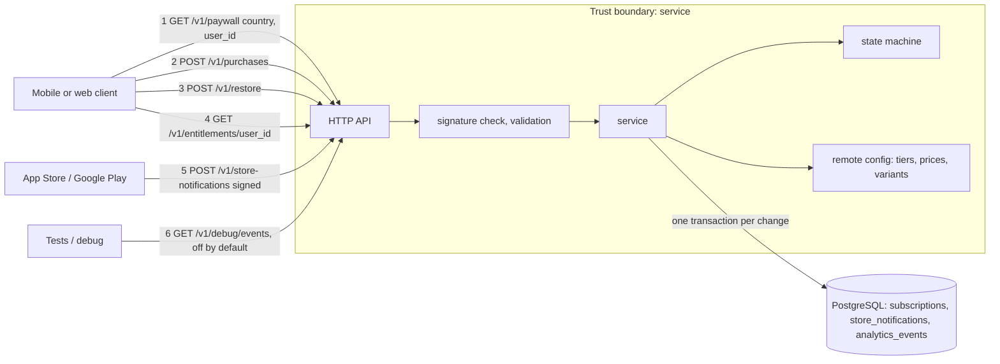

# Threat model

Scope: the subscription flows in this repository: paywall configuration by country tier, A/B assignment, trial purchase, restore, entitlement checks, store notifications, analytics events. The service is a simulation, so some gaps below are properties of the simulation and are listed as open on purpose.

Method: STRIDE per data flow. Status values:

- **Mitigated**: the code that mitigates the threat exists and an automated test in this repository fails if it is removed.
- **Mitigated (CI gate)**: the control is a scan that fails the build (secrets, dependencies, container, workflow pinning). There is no unit test for it; the evidence is the workflow job.
- **Open**: not mitigated. The planned mitigation is written in the row.

Counts: 21 threats, 13 mitigated (9 with code and tests, 4 by a CI gate), 8 open.

## Data flow

Flows:

1. **Paywall config.** The client sends a country and a user id. The service maps the country to a tier (`tier1`, `ex_tier1`), picks the A/B variant from a hash of experiment name and user id, and returns prices and trial length from `config/remote_config.json`. It writes `paywall_viewed`.
2. **Trial or paid purchase.** The client reports a simulated store purchase. The service prices it from the tier, applies the trial rules, creates the subscription and `subscription_started` in one transaction.
3. **Restore.** Counts the user's subscriptions on one store that still grant access.
4. **Entitlement check.** Reads subscriptions and computes `has_access` from state and expiry time.
5. **Store notification.** `SUBSCRIBED`, `DID_RENEW`, `EXPIRED`, `REFUND`. Verified by signature, deduplicated by `notification_id`, applied through the state machine.
6. **Analytics.** Events are written in the same transaction as the state change; the debug endpoint reads them.

## Trust boundaries

| Boundary | Untrusted side | Trusted side | Control |
|---|---|---|---|
| B1 Internet to API | Client apps and any caller | Go service | Input validation, 1 MiB body limit, security headers. No authentication yet (T08, T09). |
| B2 Store to API | Anything claiming to be a store | Go service | HMAC-SHA256 signature and timestamp window (T01 to T03). |
| B3 Service to database | none (internal) | PostgreSQL | Parameterised queries through pgx, one transaction per state change. |
| B4 Repository to CI to image | Third-party actions and dependencies | The built image | Pinned actions, SCA, container scan, secret scan (T18 to T21). |

## Store notification authenticity

Real stores protect webhooks with a signature the receiver can check without sharing a secret: App Store Server Notifications V2 arrive as a signed JWS whose certificate chain is verified up to Apple's root, and Google Play real-time developer notifications arrive through Pub/Sub push with an OIDC token that has to be verified (audience and issuer). This project has no store keys, so it models the same property with a shared secret:

- Header `X-Paywall-Timestamp`: Unix seconds.
- Header `X-Paywall-Signature`: `v1=` plus hex HMAC-SHA256 of `<timestamp>.<raw body>`.
- The body is read as raw bytes and verified before JSON parsing. Comparison is constant time (`hmac.Equal`). A timestamp more than 5 minutes from server time (either direction) is rejected. All failures return the same 401 `invalid_signature` body; the reason goes to the log.
- Secret from `NOTIFICATION_SIGNING_SECRET`; the server does not start without it. `docker-compose.yml` defaults it to a dev-only value.

A shared secret means anyone holding it can sign, and it cannot prove which store sent a request. Replacing it with JWS verification against the store's public keys is the production path.

## Threats

| ID | STRIDE | Asset | Scenario | Likelihood / impact | Mitigation | Status | Evidence |
|---|---|---|---|---|---|---|---|
| T01 | Spoofing, Elevation of privilege | Entitlement | Anyone who can reach `POST /v1/store-notifications` posts a forged `SUBSCRIBED` and gets premium for any user id. | High / High | HMAC-SHA256 over `<timestamp>.<raw body>` with `NOTIFICATION_SIGNING_SECRET`, constant-time compare, 401 `invalid_signature` for missing or wrong signature. Server refuses to start without the secret. Code: [signature.go](../internal/api/signature.go). | Mitigated | [signature_test.go](../internal/api/signature_test.go) (`TestSignatureVerification`, `TestUnsignedNotificationIsRejectedWithoutAVerifier`); [test_notification_authenticity.py](../tests/api/test_notification_authenticity.py) (`test_unsigned_subscribed_cannot_grant_premium`, `test_unsigned_refund_is_rejected_and_access_stays`) |
| T02 | Tampering | Entitlement | A valid signed request is captured and its body is changed (for example `DID_RENEW` to `REFUND`) to revoke another user's access. | Medium / High | The signature covers the exact raw bytes of the body, so any change invalidates it. | Mitigated | [signature_test.go](../internal/api/signature_test.go) (`tampered body`); [test_notification_authenticity.py](../tests/api/test_notification_authenticity.py) (`test_tampered_body_is_rejected`) |
| T03 | Repudiation, Tampering | Entitlement, analytics | A captured signed request is sent again later (replay) to double-count renewals. | Medium / Medium | Timestamp is part of the signed string and must be within 5 minutes of server time (so changing only the header fails). Inside the window, `notification_id` makes a second delivery a no-op. Residual: a replay inside the window is accepted as a duplicate, not rejected. | Mitigated | [signature_test.go](../internal/api/signature_test.go) (`stale timestamp`, `fresh timestamp header on an old signature`); [test_notification_authenticity.py](../tests/api/test_notification_authenticity.py) (`test_stale_timestamp_is_rejected_even_when_correctly_signed`, `test_replaying_a_captured_request_is_deduplicated`); [service_test.go](../internal/service/service_test.go) `TestDuplicateNotificationEmitsOneEvent` |
| T04 | Tampering | Entitlement state | Out-of-order delivery: a renewal arrives after a refund (or an expiry after a refund) and revives access. | High / High | State machine rejects renewal of a refunded subscription and keeps refunded terminal. Mutation job M1 proves the unit tests fail if that rule is removed. | Mitigated | [entitlement_test.go](../internal/entitlement/entitlement_test.go) (`refunded cannot renew`); [test_store_notifications.py](../tests/api/test_store_notifications.py) (`test_renewal_after_refund_is_rejected`, `test_expire_after_refund_changes_nothing`); [mutation/M1-refunded-renewal.patch](../mutation/M1-refunded-renewal.patch) |
| T05 | Information disclosure, Spoofing | Signing secret | The shared secret is weak, leaked, never rotated, or the compose default is used outside local development. | Medium / High | Planned: minimum length check at startup, accept two secrets during rotation, fail startup if the compose default is used with `ENV=production`. Today only an empty secret is refused. | Open | [signature_test.go](../internal/api/signature_test.go) `TestNewSignatureVerifierRejectsEmptySecret` covers the empty case only |
| T06 | Tampering | Price | The client sends its own price or tier in a purchase and is charged less. | High / Medium | Price comes from server config by tier. Unknown request fields are rejected with 400, so `price_cents` cannot be sent. | Mitigated | [server_test.go](../internal/api/server_test.go) (`purchase unknown field`); [test_purchases.py](../tests/api/test_purchases.py) (`test_charged_price_matches_the_price_book`, `test_bad_field_is_rejected[price_cents=1]`) |
| T07 | Tampering | Country tier | The client reports a tier-2 country (VPN, edited request) to get the lower price. | High / Medium | Country is self-reported by design in this simulation. Planned: take the storefront country from the verified store receipt or the signed notification, not from the client. | Open | none |
| T08 | Spoofing, Elevation of privilege | Entitlement | `POST /v1/purchases` has no receipt or payment verification and no caller authentication, so any caller can create an active subscription for any user id without paying. | High / High | The signature fix protects the notification path only. Planned: purchases are created only from a verified store receipt or from a signed `SUBSCRIBED` notification, and the client endpoint only links an existing purchase to the caller's account. | Open | none |
| T09 | Information disclosure | Entitlement data | `GET /v1/entitlements/{user_id}` and `POST /v1/restore` take the user id from the URL or body and have no authentication, so anyone can read another user's subscriptions (IDOR). | High / Medium | Planned: bearer token bound to the user id, with the id taken from the token. `test_users_do_not_see_each_others_subscriptions` only shows data is separated per id, not that access is authorised, so it is not counted as a mitigation. | Open | none |
| T10 | Elevation of privilege | Entitlement | Access stays on after refund, expiry or cancellation. | High / High | `HasAccess` checks state and expiry time on every read. Mutation job M2 and M3 prove the tests fail if a renewal revives an expired subscription or the expiry check is dropped. | Mitigated | [test_store_notifications.py](../tests/api/test_store_notifications.py) (`test_refund_revokes_access_for_an_active_subscription`, `test_expired_revokes_access`, `test_active_state_with_a_past_expiry_does_not_grant_access`); [mutation/](../mutation/) |
| T11 | Tampering (state desync) | Paywall | A user with premium is still shown the paywall: `GET /v1/paywall` and the page script never consult entitlements, so the decision is left to the client app. | Medium / Low (revenue and UX, not access) | Planned: include `has_access` in the paywall response, or return 204 for users with access, and add an API and an E2E test. | Open | none |
| T12 | Tampering | A/B assignment | The client picks `user_id` values until it lands in the preferred variant. | Medium / Low | Variant is a deterministic hash of experiment and user id (so it is stable, and tests pin it), but the id is client-chosen. Accepted for a simulation; in production the id comes from an authenticated session. | Open | [test_paywall.py](../tests/api/test_paywall.py) covers stability only, not abuse |
| T13 | Tampering, Repudiation | Analytics events | Any caller can emit `paywall_viewed` for any user id and skew funnel metrics. Events for purchases and renewals are written in the same transaction as the state change, so they cannot be forged without a state change. | Medium / Low | Planned: authenticated caller for `paywall_viewed`, or mark unauthenticated views as such. | Open | none for `paywall_viewed`; [service_test.go](../internal/service/service_test.go) covers the transactional events |
| T14 | Information disclosure | Analytics events | `GET /v1/debug/events` returns every event for a user id. | Medium / Medium | Route is not registered unless `ENABLE_DEBUG_ENDPOINTS=true` (default false). Filters are validated (a ZAP run found `user_id=%00` returning 500). Residual: `docker-compose.yml` turns it on for the test stack, so the compose stack must not be exposed. | Mitigated | [server_test.go](../internal/api/server_test.go) `TestRoutingRules` (404 when off); [middleware_test.go](../internal/api/middleware_test.go) `TestDebugEventsRejectsBadFilters`; [test_security_headers.py](../tests/api/test_security_headers.py) (`test_debug_events_rejects_malformed_filters`) |
| T15 | Repudiation, Tampering | Logs | A client-supplied `X-Request-Id` or URL path with line breaks forges log lines (CodeQL `go/log-injection`). | Low / Low | Request id from the client is accepted only if it matches `[A-Za-z0-9._-]{1,64}`; line breaks are stripped from logged paths. | Mitigated | [middleware_test.go](../internal/api/middleware_test.go) (`TestRequestIDFromClientIsSanitised`, `TestLogSafeStripsLineBreaks`) |
| T16 | Tampering, Information disclosure | Paywall page | Script injection or framing of the paywall page. | Low / Medium | Page text is set with `textContent` only; responses carry CSP (`default-src 'self'`), `X-Frame-Options: DENY`, `nosniff`, `Referrer-Policy`, `Cross-Origin-Resource-Policy`. | Mitigated | [middleware_test.go](../internal/api/middleware_test.go) `TestSecurityHeadersOnPageAndAPI`; [test_security_headers.py](../tests/api/test_security_headers.py) |
| T17 | Denial of service | Availability | Unauthenticated write endpoints with no rate limit can be flooded and fill the database. | Medium / Medium | Existing: 1 MiB body limit and read-header timeout. Missing: rate limiting, per-user quotas. Planned: reverse-proxy limit plus per-IP limit in the service. | Open | none |
| T18 | Information disclosure | Secrets | A real secret is committed. | Low / High | gitleaks scans the full history on every push, PR and weekly. GitHub secret scanning with push protection is enabled on the repository. The only secrets in the repo are dev or CI dummy values (`dev-only-notification-secret`, `ci-only-dummy-secret`, local database password). | Mitigated (CI gate) | [security.yml](../.github/workflows/security.yml) job `gitleaks` (first run: 16 commits scanned, 0 leaks) |
| T19 | Tampering, Elevation of privilege | Dependencies | A known-vulnerable Go module, Go standard library or Python test dependency. | High / Medium | govulncheck and pip-audit fail the build; Trivy fails on fixable HIGH/CRITICAL; Dependabot opens update PRs weekly. This found real issues on the first run (see SECURITY_FINDINGS.md). | Mitigated (CI gate) | [security.yml](../.github/workflows/security.yml) jobs `sca`, `trivy`; [dependabot.yml](../.github/dependabot.yml) |
| T20 | Elevation of privilege | Container | Container runs as root or ships vulnerable OS packages. | Low / High | Distroless static image, explicit `USER nonroot:nonroot`, Trivy gate on the built image. | Mitigated (CI gate) | [Dockerfile](../Dockerfile); [security.yml](../.github/workflows/security.yml) job `trivy` |
| T21 | Tampering | CI pipeline | A compromised third-party GitHub Action runs with repository access. | Low / High | Actions pinned to commit SHAs (version in a comment), workflow `permissions` limited to `contents: read` plus `security-events: write` only where SARIF is uploaded, Dependabot updates the pins. Semgrep rule `github-actions-mutable-action-tag` fails on unpinned actions. | Mitigated (CI gate) | [security.yml](../.github/workflows/security.yml) job `semgrep` |

## Not covered

Real receipt validation, user accounts and sessions, rate limiting, TLS (terminated in front of the service in a real deployment), multi-region and data retention.

See also: [SECURITY_FINDINGS.md](SECURITY_FINDINGS.md), [SSDF_SAMM_MAPPING.md](SSDF_SAMM_MAPPING.md), [TEST_PLAN.md](TEST_PLAN.md).
